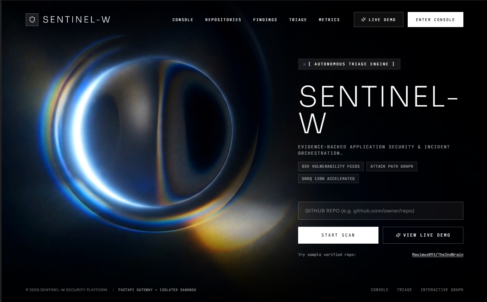

# 🛡️ SentinelFlow — Autonomous Application Security & Incident Triage Platform

<div align="center">

[](https://www.typescriptlang.org/)
[](https://reactjs.org/)
[](https://vitejs.dev/)
[](https://tailwindcss.com/)
[](https://fastapi.tiangolo.com/)
[](https://www.python.org/)
[](https://github.com)
[](https://opensource.org/licenses/MIT)

**Evidence-backed application security intelligence platform that automates vulnerability discovery, static code analysis (SAST), software composition analysis (SCA), architecture attack graph synthesis, and Human-in-the-Loop (HITL) incident triage.**

[Key Features](#-key-features) • [Architecture](#-architecture--workflow) • [Multi-Model AI Engine](#-multi-model-ai-intelligence-byok) • [Screenshots & Modules](#-core-modules--dashboard-pages) • [Quick Start](#-quick-start) • [API Specification](#-backend-api-specification) • [Deployment](#-deployment--production)

</div>

---

<p align="center">
  
</p>

## 🌟 Executive Summary

Modern engineering and DevSecOps teams face an overwhelming flood of security alerts. Traditional scanners produce **85%+ unreachable false positives**, provide disconnected CVE lists without call-graph context, and leave engineers with hours of manual patch authoring.

**SentinelFlow** operates as a **Level-2 Autonomous Security Analyst**:
1. **Scans & Ingests Repositories Safely:** Multi-layered defense-in-depth with socket-level Anti-SSRF DNS pinning and isolated sandboxing.
2. **Correlates Findings Across Layers:** Synthesizes dependency advisories (OSV.dev / CVE databases), Abstract Syntax Tree (AST) syntax validation, and ingress-to-sink reachability.
3. **Constructs Visual Attack Path Graphs:** Maps the complete exploit chain from external HTTP route entrypoints down to database and memory sinks.
4. **Autonomous Triage with HITL Controls:** High-confidence/low-risk issues generate automated unified git diff patches; critical or ambiguous threats generate SSE `interrupt` events that escalate to human analysts in an idempotent triage queue.
5. **Universal Multi-Model AI (BYOK):** Pluggable intelligence supporting Google Gemini (2.5 Flash, 2.5 Pro, 3.8 Flash), Anthropic Claude (3.7 Sonnet, 3.5 Sonnet/Haiku), OpenRouter (DeepSeek R1, GPT-4o, Llama 3.3), xAI Grok 2, Groq LPUs (500+ tok/s), and a 100% offline deterministic AST fallback engine.

---

## 🎯 Key Features

- **🔍 Dual-Engine Repository Scanner**
  - High-speed SAST pattern detection across TypeScript, JavaScript, Python, Go, and Java.
  - Software Composition Analysis (SCA) querying OSV.dev and NVD vulnerability databases.
  - Secret and API token exposure detection with high-entropy validation.

- **🕸️ Ingress-to-Sink Attack Path Graph Canvas**
  - Interactive SVG visual graph mapping entrypoints (`POST /api/upload`, `GET /reports`), middleware gates, and sinks (`child_process.exec`, `eval`, `db.query`).
  - Reachability analysis determining whether vulnerable code is actually callable from public ingress.
  - Node inspector rendering live AST syntax trees, vulnerable code snippets, and unified git diffs.

- **🤖 Multi-Model AI Triage & Patch Synthesis (BYOK)**
  - Seamlessly switch between **Gemini**, **Claude**, **OpenRouter**, **xAI Grok**, and **Groq** via a single unified switcher modal.
  - User-provided API keys stored securely in-session (server-side proxy routes, zero browser key leakage).
  - Built-in **SentinelFlow AST Engine** operates completely offline with zero external dependencies.

- **🛡️ Human-in-the-Loop (HITL) Analyst Queue**
  - High-blast-radius or low-confidence vulnerabilities pause automated workflows via Server-Sent Events (`step` ➔ `interrupt` ➔ `done`).
  - Analysts claim, evaluate, comment, or approve remediations with strict `Idempotency-Key` and `If-Match` optimistic concurrency control.

- **🩹 Automated Remediation Center**
  - Synthesizes production-ready `.patch` files and unified diffs.
  - One-click copy, download, or direct pull request generation.
  - Semantic explanations highlighting root cause, exploit vectors, and defensive changes.

- **📈 Real-Time SOC Observability & Guardrails**
  - Live metric dashboards: MTTD (Mean Time to Detect), MTTR (Mean Time to Remediate), vulnerability burn-down charts, and severity distributions.
  - Security guardrails monitor showing blocked SSRF attempts, DNS pinning hits, rate-limiting violations, and scanner sandbox integrity.
  - Contextual vector memory explorer for prior incident precedents and remediation strategies.

---

## 🏗️ Architecture & Workflow

```
                        [ GitHub Repository / Git URL ]
                                       │
                                       ▼
     ┌──────────────────────────────────────────────────────────────────┐
     │ 1. INGESTION & DEFENSE-IN-DEPTH GUARDRAILS                       │
     │    • Anti-SSRF DNS Pinning (blocks RFC 1918, 127.0.0.1 & AWS meta)│
     │    • Flag barrier git isolation (prohibits arbitrary shell exec) │
     │    • Ephemeral sandbox workspace isolation                       │
     └─────────────────────────────────┬────────────────────────────────┘
                                       │
                                       ▼
     ┌──────────────────────────────────────────────────────────────────┐
     │ 2. REPOSITORY RESEARCH & STATIC DISCOVERY ENGINE                 │
     │    • Manifest Parsers (package.json, requirements.txt, go.mod)   │
     │    • OSV.dev Database Querying & Advisory Cache                  │
     │    • Abstract Syntax Tree (AST) Taint Analysis                   │
     │    • Ingress / Route Extraction (Express, FastAPI, Next.js)      │
     └─────────────────────────────────┬────────────────────────────────┘
                                       │
                                       ▼
     ┌──────────────────────────────────────────────────────────────────┐
     │ 3. GRAPH-BASED ATTACK PATH MODELING                              │
     │    • Directed Graph: Ingress Route ➔ Component ➔ Vulnerable Sink │
     │    • Reachability Analysis (Call-graph reachability validation)  │
     │    • Composite CVSS v3.1 & Blast Radius Scoring                  │
     └─────────────────────────────────┬────────────────────────────────┘
                                       │
                                       ▼
     ┌──────────────────────────────────────────────────────────────────┐
     │ 4. AUTONOMOUS AI TRIAGE DISPATCHER (SSE Real-Time Stream)        │
     │    • Model: Gemini 2.5 | Claude 3.7 | DeepSeek R1 | Grok 2 | LPU │
     │    • Stream Protocol: "step" ➔ "interrupt" (if high threat) ➔    │
     │      "done"                                                      │
     └─────────────────────────────────┬────────────────────────────────┘
                                       │
                    ┌──────────────────┴──────────────────┐
                    ▼                                     ▼
     [ Low / Medium Confidence ]               [ Critical / High Blast ]
     Automated Patch Synthesis                 Human-in-the-Loop Escalation
     • Unified Git Diff (.patch)               • Incident Queue (/queue)
     • Backward-compatibility check            • Idempotent Claim & Review
     • Ready for Pull Request                  • Policy Compliance Sign-off
```

---

## 🧠 Multi-Model AI Intelligence (BYOK)

SentinelFlow provides a unified, vendor-agnostic AI Dispatcher (`src/server/ai-dispatcher.ts`). You can select your preferred intelligence engine, enter an API key, or rely on the built-in offline engine:

| Provider | Supported Models | Primary Specialty | Context Window |
|---|---|---|---|
| **Google Gemini** | `gemini-2.5-flash` ⭐<br>`gemini-2.5-pro`<br>`gemini-3.8-flash` | Ultra-fast multi-modal reasoning, real-time AST triage, deep patch synthesis | Up to **2,000,000 tokens** |
| **Anthropic** | `claude-3-7-sonnet` ⭐<br>`claude-3-5-sonnet`<br>`claude-3-5-haiku` | Hybrid reasoning, superior code auditing, complex multi-file taint correlation | **200,000 tokens** |
| **OpenRouter** | `anthropic/claude-3.7-sonnet`<br>`deepseek/deepseek-r1` ⭐<br>`openai/gpt-4o`<br>`meta-llama/llama-3.3-70b` | Global routing, open-weight reasoning (DeepSeek R1), multi-provider redundancy | **128,000 – 1M tokens** |
| **xAI Grok** | `grok-2-1212` ⭐<br>`grok-2-vision-1212`<br>`grok-beta` | Premier code reasoning, real-time threat telemetry, architectural validation | **131,072 tokens** |
| **Groq LPU** | `openai/gpt-oss-120b` ⭐<br>`llama-3.3-70b-versatile`<br>`qwen/qwen3.8-27b` | Sub-second inference at **500+ tokens/sec** on custom LPU silicon | **128,000 tokens** |
| **SentinelFlow AST** | `sentinelflow-ast-v2` | Deterministic local AST engine. **100% offline, zero API keys required** | Native AST Tree |

> 🔒 **Security Notice:** API keys are never written to disk, never printed to client logs, and never exposed in `localStorage`. They are managed server-side via memory-isolated proxy routes with real-time test validation (`/api/ai/test-key`).

---

## 🖥️ Core Modules & Dashboard Pages

SentinelFlow provides a comprehensive 12-page console:

### 1. 🌌 ConSentinel Landing (`/`)
- Frosted glass design system with real-time live telemetry tickers.
- One-click public repository scanner (pre-configured targets or custom Git URL).
- Instant security score overview, live vulnerability stream, and architecture highlights.

### 2. ⚡ Live Interactive Scan & Workflow Visualizer (`/scans/:id` & `/demo`)
- 7-stage automated scanning pipeline:
  1. *Repository Ingestion & Anti-SSRF Validation*
  2. *Manifest Dependency Graph Resolution*
  3. *OSV & NVD Advisory Correlation*
  4. *AST Taint Analysis & Static Inspection*
  5. *Ingress-to-Sink Attack Path Graph Construction*
  6. *Autonomous AI Incident Triage & Synthesis*
  7. *Remediation Patch Generation & Verification*
- Interactive visual graph with SVG bezier curves, node-click inspectors, AST diff viewer, and real-time execution logs.

### 3. 🛡️ Findings Matrix (`/findings`)
- Filter and search by severity (Critical, High, Medium, Low), category (SCA, SAST, Secrets, Infrastructure), and reachability status.
- Direct drill-down to file locations, line numbers, CVSS scores, and CWE categorizations.
- "Inspect in Workflow Graph" button linking findings directly to their exploit path.

### 4. 🕸️ Attack Paths Graph (`/attack-paths`)
- Visual call-graph connecting external entrypoint routes to vulnerable sinks.
- Live path reachability evaluation: isolates real exploits from theoretical vulnerabilities.
- Blast radius estimation and impacted microservices breakdown.

### 5. 🩹 Remediation Center (`/remediation`)
- Pre-synthesized unified `.patch` files ready for `git apply`.
- Side-by-side AST before/after code diffs.
- Automatic verification test generation to prevent regression.

### 6. 🧑‍💻 Human-in-the-Loop Analyst Queue (`/queue`)
- Real-time escalation queue for incidents requiring human review.
- Idempotent claim/release mechanics (`POST /incidents/{id}/claim`).
- Analyst decision controls: **Approve Patch**, **Escalate to Security Team**, or **Mark as Compensating Control / False Positive**.

### 7. 📊 Incident Deep Dive (`/incidents/:id`)
- Complete audit trail of AI agent decisions, tool invocations, and raw SSE events.
- Timeline view of discovery, analysis, escalation, and resolution.

### 8. 📡 SOC Monitoring & Telemetry (`/monitoring`)
- Real-time charts for scan velocity, active incidents, resolution rates, and vulnerability trends.
- Service health breakdown across ingestion workers, OSV cache, and AI providers.

### 9. 🚧 Defense-in-Depth Guardrails (`/guardrails`)
- Real-time audit log of blocked SSRF network connections.
- DNS resolution inspection preventing metadata server spoofing.
- Sandboxed process execution telemetry.

### 10. 🧠 Memory & Context Store (`/memory`)
- Vector semantic search over historical incidents, CVE mitigations, and organization-specific security guidelines.

### 11. ⚖️ Model Evals & Benchmarks (`/evals`)
- Comparative benchmark scores across Gemini, Claude, Grok, and Groq on precision, recall, hallucination rate, and patch validity.

### 12. ⚙️ AI Settings & Model Control (`/settings`)
- Configure active AI provider, model selection, API key testing, and scanning presets.

---

## 🎨 Design System & Accessibility

Built strictly according to high-performance AppSec cockpit standards:
- **Light, High-Contrast Console:** Optimized for multi-hour incident review without eye fatigue (flat `#E6EDF6` canvas, crisp `#FFFFFF` cards, 1px `#DDE4EE` borders).
- **Zero Ambiguity Severity Indicators:** Severity is always indicated with three distinct dimensions: **Symbol + Text + Tint**:
  - `Critical`: 🛑 `#A1121F` on `#FADADD`
  - `High`: ⚠️ `#9A3B0B` on `#FCE4D6`
  - `Medium`: ⚡ `#7A5200` on `#FBF0D9`
  - `Low`: ℹ️ `#1F4E79` on `#E3EEF8`
- **Performance Optimized:** Route-based `React.lazy` code splitting, native `<dialog>` modals, SVG stroke rendering with hardware acceleration, and polling throttled to active window focus.

---

## 🚀 Quick Start

### Prerequisites
- **Node.js** 20.x or higher
- **npm** or **bun**
- *(Optional)* Python 3.11+ for native FastAPI backend services

### 1. Clone the Repository
```bash
git clone https://github.com/your-org/sentinelflow.git
cd sentinelflow
```

### 2. Install Dependencies
```bash
npm install
```

### 3. Configure Environment Variables
Copy the example environment file:
```bash
cp .env.example .env
```

Configure your preferred API keys (or use the built-in offline engine or in-app BYOK modal):
```env
# Optional: Set default keys (or enter them directly in the UI)
GEMINI_API_KEY=your_gemini_api_key_here
ANTHROPIC_API_KEY=your_anthropic_api_key_here
OPENROUTER_API_KEY=your_openrouter_api_key_here
GROK_API_KEY=your_xai_grok_key_here
GROQ_API_KEY=your_groq_api_key_here

# Application Configuration
PORT=3000
VITE_USE_MOCK=false
```

### 4. Start the Fullstack Application
```bash
npm run dev
```

The application will start at **`http://localhost:3000`** with full Express backend API routes and hot-reloading Vite frontend.

### 5. (Optional) Run the Python FastAPI Analyzer
If you wish to run the specialized Python static analyzer and graph generator:
```bash
cd backend
python -m venv .venv
source .venv/bin/activate  # Or `.venv\Scripts\activate` on Windows
pip install -r requirements.txt
uvicorn app.main:app --port 8000 --reload
```

---

## 📡 Backend API Specification

SentinelFlow provides a clean, idempotent REST + Server-Sent Events (SSE) contract:

### 🤖 Multi-Model AI Endpoints
| Method | Endpoint | Description |
|---|---|---|
| `GET` | `/api/ai/status` | Returns active provider, current model, and configured key flags |
| `GET` | `/api/ai/models` | Lists all supported models across Gemini, Claude, OpenRouter, Grok, Groq, and SentinelFlow |
| `POST` | `/api/ai/configure` | Sets active provider, model, and optional session API key |
| `POST` | `/api/ai/test-key` | Validates an API key against the provider's upstream authentication endpoint |
| `POST` | `/api/ai/analyze` | Initiates real-time AI repository triage and patch synthesis |
| `POST` | `/api/ai/explain` | Generates detailed root-cause and exploit chain breakdown |
| `POST` | `/api/ai/remediate` | Generates unified git diff patch for a specific finding |

### 🔍 Repository & Scan Endpoints
| Method | Endpoint | Description |
|---|---|---|
| `POST` | `/api/repositories` | Registers and validates a target Git repository |
| `POST` | `/api/scans` | Initiates a comprehensive vulnerability & attack path scan |
| `GET` | `/api/scans/:id` | Returns current scan pipeline status and telemetry |
| `GET` | `/api/scans/:id/graph` | Returns the directed attack path graph (nodes, edges, sinks) |
| `GET` | `/api/runs/:id/stream` | **Server-Sent Events (SSE)** streaming live agent trace steps |

### 🛡️ Human-in-the-Loop Incident Queue
| Method | Endpoint | Description |
|---|---|---|
| `GET` | `/api/incidents` | Lists escalated incidents requiring analyst review |
| `GET` | `/api/incidents/:id` | Returns complete incident dossier and AST context |
| `POST` | `/api/incidents/:id/claim` | Idempotently claims an incident for triage (`Idempotency-Key` header) |
| `POST` | `/api/incidents/:id/release` | Releases an incident back to the general pool |
| `POST` | `/api/incidents/:id/decision` | Submits analyst verdict with `If-Match` optimistic locking |

---

## 🔒 Security & Defense-in-Depth

SentinelFlow adheres strictly to offensive and defensive AppSec standards:

1. **Zero Client Secret Storage:** No API tokens or passwords reside in `localStorage`, `sessionStorage`, or client-accessible cookies.
2. **Anti-SSRF Protection:** Ingestion workers validate all remote targets against DNS rebinding, blocking loopback (`127.0.0.0/8`), RFC 1918 subnets (`10.0.0.0/8`, `172.16.0.0/12`, `192.168.0.0/16`), link-local (`169.254.0.0/16`), and AWS/GCP cloud metadata services.
3. **Command Injection Immunization:** Git and compiler operations run strictly with argument arrays and flag delimiters (`--`), preventing argument injection attacks.
4. **Optimistic Locking:** All state transitions in the incident triage queue use `If-Match: "<version>"` headers to prevent race conditions during high-tempo incident triage.

---

## 🧪 Testing & Validation

Run comprehensive verification across the codebase:

```bash
# Type-check TypeScript codebase
npm run lint

# Build production bundle
npm run build

# Run Python analyzer tests (if using Python backend)
cd backend && pytest
```

---

## 🗺️ Project Roadmap

- [x] Multi-Model AI Dispatcher (Gemini, Claude 3.7, OpenRouter, Grok 2, Groq, SentinelFlow AST)
- [x] Interactive SVG Ingress-to-Sink Attack Path Graph Canvas
- [x] Human-in-the-Loop SSE streaming triage queue with idempotent claims
- [x] Automated Unified Git Diff patch synthesis (`.patch`)
- [x] Real-time Anti-SSRF and DNS pinning guardrail monitors
- [ ] Automated GitHub App integration for continuous PR check runs
- [ ] Kubernetes cluster ingress controller scan agent
- [ ] eBPF runtime dynamic reachability correlation

---

## 📄 License

This project is licensed under the **MIT License** — see the [LICENSE](LICENSE) file for details.

---

<div align="center">

**Built with precision for Security Engineers, DevSecOps Teams, and Incident Responders.**  
*SentinelFlow — Autonomous Application Security Intelligence.*

</div>
